# 企业智能知识库系统 · Java 微服务 + AI 问答 + RAG 检索

> 一套可落地的企业知识库后端：文档全生命周期管理、混合检索、AI 智能问答、
> 知识图谱、RBAC 权限。Java（Spring Cloud）与 Python（FastAPI）双后端实现，10 个微服务模块，192 个 Java 源文件。

>  如果这个项目对你有帮助，欢迎点个 Star ⭐
> 
## 前言

企业智能知识库系统目前包含三个项目：
1. React前端项目
2. Java后端项目
3. Python后端项目（基于FastAPI）

这个系统非常实用，可以直接写到简历中，很加分。

通过这个系统，大家可以前端、Java、Python和AI技术一起学习。

> 更多 Java 实战项目和从 0 到 1 的教程，见苏三官网：[susan.net.cn/project](https://www.susan.net.cn/project)，官网首页：[susan.net.cn](https://www.susan.net.cn)

## 一、项目介绍

### 这个项目是干什么的？

简单说：**让企业里的知识真正流动起来。**

你在公司里是不是经常遇到这些情况：

- 找一个接口文档，要翻 Confluence、语雀、飞书、本地 Markdown，最后还是问同事才找到。
- 新同事入职，面对一片信息孤岛，没人告诉他该看什么、从哪看起。
- 核心员工离职，人走了知识也走了，留下的文档三年没更新过。
- 想用 AI 赋能知识管理，但市面上的 SaaS 方案要么太贵，要么数据安全过不了关。

**企业智能知识库系统**就是为解决这些问题而生的。

它覆盖了从文档创建、分类存储、混合智能检索、权限审批、版本管理，到 AI 智能问答、AI写作、知识图谱分析的全链路。


### 项目规模有多大？

| 维度 | 数据 |
|------|------|
| 后端技术栈 | **两套可选**：Java 版 / Python 版 |
| Java 版微服务模块 | **10个**，Java 源文件 **192个** |
| Python 版微服务模块 | **8个**，Python 源文件 **120+个** |
| REST API 端点 | **近200个**（两套后端功能对等） |
| 前端功能页面 | **34个** |
| 数据库（MySQL） | **9个**，共 29 张业务表 |
| 中间件集成 | Java 版 **7种** / Python 版 **7种** |
| 后端代码量 | Java 版 **20,000+ 行** / Python 版 **15,000+ 行** |
| 前端代码量 | **16,000+ 行** TypeScript/TSX |
| 总代码量 | **50,000+ 行**（含两套后端） |

这个项目提供了 **Java 和 Python 两套后端实现**，功能完全对等，你可以根据自己的技术栈偏好选择其中一套来学习和使用。

两套后端遵循相同的 REST API 规范，前端不需要改动。

### 系统架构一览

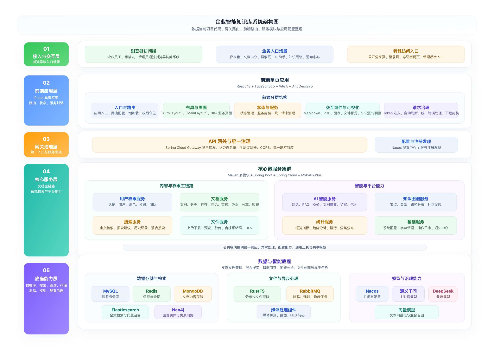

**架构亮点：** 项目提供 **Java 和 Python 两套独立的后端实现**。

Java 版基于 Spring Cloud Alibaba 微服务体系，Python 版基于 FastAPI + LangChain。

两套后端功能对等（文档管理、搜索、AI问答、权限管控等核心能力完全一致），共享同一套前端。

根据你的团队技术栈选择一套即可，部署方案各自独立。


## 二、使用技术

### Java后端技术栈

| 技术 | 版本 | 在项目里的实际用途 |
|------|------|-------------------|
| **Java** | 21 LTS | 虚拟线程、Record类、模式匹配 |
| **Spring Boot** | 3.2.0 | 所有微服务的基础框架 |
| **Spring Cloud** | 2023.0.0 | 微服务治理、服务间调用 |
| **Spring Cloud Alibaba** | 2023.0.1.0 | Nacos 注册中心 & 配置中心集成 |
| **Spring Cloud Gateway** | - | 统一 API 网关、路由转发、CORS |
| **MyBatis Plus** | 3.5.8 | 所有数据库的 ORM 操作 |
| **Druid** | 1.2.20 | 数据库连接池 + SQL 监控 |
| **MySQL** | 8.0 | 9 个业务数据库，22+ 张表 |
| **Redis** | 7.x | 缓存、Session、实时排行榜 |
| **Elasticsearch** | 7.x | 全文检索 + 向量存储 |
| **MongoDB** | 6.x | 文档正文内容存储 |
| **Neo4j** | 5.x | 知识图谱节点和关系存储 |
| **RabbitMQ** | 3.x | 异步消息（转码、索引同步、通知） |
| **LangChain4j** | 0.29.1 | LLM 集成框架，统一模型调用 |
| **Knife4j** | 4.3.0 | 自动生成 Swagger API 文档 |
| **JWT (JJWT)** | 0.12.3 | 无状态身份认证 |
| **Hutool** | 5.8.24 | 通用工具库 |

### Python 后端技术栈

除了 Java 版之外，项目还提供了完整的 **Python 版后端实现**。

两套后端功能对等、API 接口一致、共享同一套前端。如果你主攻 Python 方向，或者团队正在从 Java 向 Python 转型，可以直接选择这套：

| 技术 | 版本 | 在项目里的实际用途 |
|------|------|-------------------|
| **Python** | 3.12 | 类型注解、match-case 模式匹配、asyncio 协程 |
| **FastAPI** | 0.115+ | 高性能异步 Web 框架，替代 Spring Boot，自动生成 Swagger 文档 |
| **Pydantic** | 2.x | 请求/响应数据校验与模型定义，替代 Java Bean Validation |
| **SQLAlchemy** | 2.0+ | 异步 ORM，替代 MyBatis Plus，管理所有业务表的 CRUD |
| **Alembic** | - | 数据库迁移工具，替代 Flyway/Liquibase |
| **Uvicorn + Gunicorn** | - | ASGI 多 worker 服务器，并发模型替代 Tomcat/Nginx |
| **FastAPI Users** | - | JWT 认证 + RBAC 权限体系，替代 Spring Security + JJWT |
| **LangChain** | 0.3+ | LLM 统一调用编排、RAG Pipeline 构建 |
| **LangGraph** | 0.2+ | 多步骤 AI Agent 编排引擎，状态图驱动 |
| **OpenAI SDK** | 1.x | 兼容多模型 API（通义千问 / DeepSeek / GLM-4） |
| **Sentence-Transformers** | 3.x | 本地 Embedding 模型（BGE-M3, 1024维） |
| **Elasticsearch** | 7.x | 全文检索 + 向量存储 |
| **MongoDB** | 6.x | 文档正文内容 + 自动保存历史 |
| **Neo4j** | 5.x | 知识图谱节点和关系存储 |
| **Redis** | 7.x | 缓存、Session、Celery 消息 Broker |
| **Celery** | 5.4+ | 异步任务队列（文档解析、向量嵌入、视频转码、通知推送） |
| **RabbitMQ** | 3.x | 可选的消息队列（与 Celery 互补，跨团队解耦） |
| **httpx** | 0.28+ | 异步 HTTP 客户端，服务间 RPC 调用 |
| **FastStream** | - | Kafka/RabbitMQ 事件流处理框架 |
| **tiktoken** | - | 精确 Token 计数与分块边界控制 |

> **为什么提供 Python 版？** 很多团队在后端语言选型上存在分歧：Java 派看重稳定性和企业生态，Python 派看重 AI 生态和开发效率。

这个项目直接把两套都做了出来，功能完全对等、API 接口一致、共享同一个前端。

**你想用 Java 就用 Java 版，想用 Python 就用 Python 版，不用纠结二选一错过什么。**

### 前端技术栈

| 技术 | 版本 | 在项目里的实际用途 |
|------|------|-------------------|
| **React** | 18.3.1 | 核心 UI 框架 |
| **TypeScript** | 5.3.3 | 严格模式，零类型错误 |
| **Vite** | 5.1.0 | 构建工具，SWC 编译，秒级热更新 |
| **Ant Design** | 5.14.0 | 企业级 UI 组件库，中文 locale |
| **React Router** | 6.22.0 | 客户端路由 + 懒加载 + 权限守卫 |
| **Zustand** | 4.5.0 | 轻量级状态管理 + persist 持久化 |
| **Axios** | 1.6.7 | HTTP 请求 + token 自动刷新 + 重试队列 |
| **ECharts** | 5.6.0 | 数据可视化图表 |
| **react-markdown** | 9.0.1 | Markdown 渲染 + GFM 支持 |
| **react-syntax-highlighter** | 16.1.1 | 代码块语法高亮 |
| **react-pdf** | 10.4.1 | PDF 在线预览 |
| **mammoth** | 1.8.0 | DOCX 转 HTML 预览 |
| **xlsx** | 0.18.5 | Excel 表格解析和预览 |

### 中间件 & 基础设施

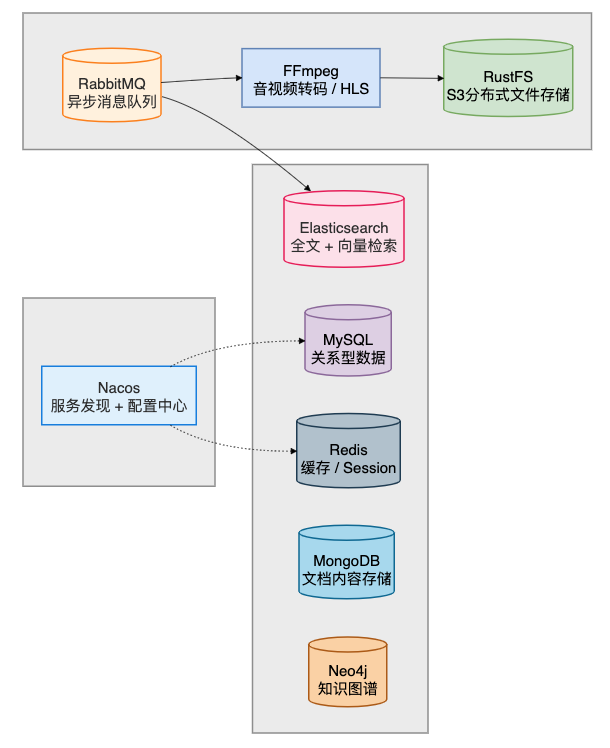


## 三、功能介绍

这系统不是一个 CRUD 壳子。

我把最核心的功能一个一个拆开来说。

### 3.1 文档全生命周期管理

从一篇文档的诞生到归档，每个环节都管到了：

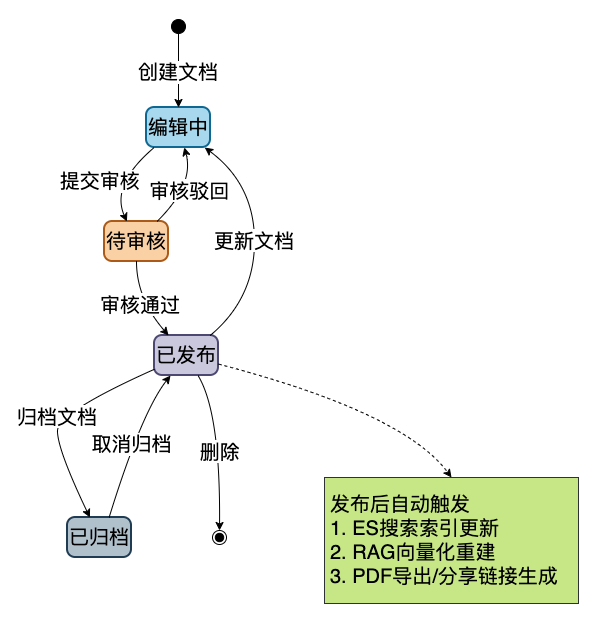


**详细功能清单：**

- **Markdown 编辑器**：实时预览、代码块语法高亮、表格、数学公式、GFM 支持
- **版本管理**：每次修改自动存一版，支持版本对比和任意版本回滚
- **审批流程**：文档发布需审核，审核人可以批通过也可以驳回并给出修改意见
- **分类体系**：无限级联分类树，支持拖拽移动
- **标签系统**：灵活打标签，热门标签自动排序
- **评论互动**：可对文档评论、回复、点赞
- **收藏 & 点赞**：社区化的知识互动机制
- **文档分享**：生成带密码保护的分享链接，可设置有效期
- **PDF 导出**：一键导出 Markdown → PDF
- **文档导入**：支持 Word (.docx) / Markdown (.md) / 纯文本批量导入
- **最近访问**：自动记录浏览历史，方便快速回溯
- **草稿箱**：未完成的文档自动保存为草稿

### 3.2 文件管理中心

统一的文件管理平台，不只是存文件，而是**全格式在线预览**：

| 类别 | 支持格式 | 预览方式 |
|------|---------|---------|
| PDF | .pdf | react-pdf 渲染，支持缩放、翻页 |
| Word | .doc / .docx | mammoth 转 HTML 渲染 |
| Excel | .xls / .xlsx | SheetJS 解析为交互式表格 |
| PPT | .ppt / .pptx | 后端提取幻灯片为图片预览 |
| Markdown | .md | react-markdown + 代码高亮 |
| 纯文本 | .txt | 等宽字体渲染 |
| 图片 | .png / .jpg / .gif / .bmp / .svg | 原生预览 + 缩略图 |
| 视频 | .mp4 / .avi / .mov / .mkv / .webm | HTML5 Video + HLS 自适应码率 |
| 音频 | .mp3 / .wav / .flac / .aac / .ogg | HTML5 Audio 播放 |
| 压缩包 | .zip / .rar / .7z | 文件列表展示 |

视频文件还支持：
- **大文件上传**：最大 2GB
- **自动 HLS 转码**：FFmpeg 异步转码，生成 360p + 720p 多码率
- **自适应码率播放**：根据网络自动切换清晰度
- **SHA-256 秒传**：相同文件不重复上传

### 3.3 智能搜索

这不是简单的数据库 LIKE 模糊查询，而是基于 Elasticsearch 的**企业级搜索引擎**：


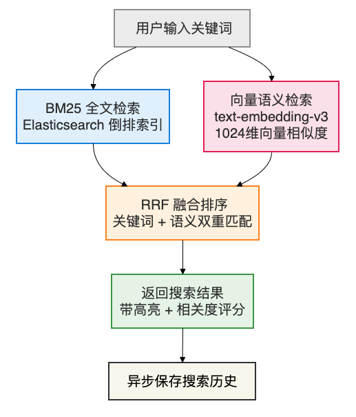

**搜索能力：**

- **全文搜索**：输入任何关键词，秒级返回匹配文档
- **高级搜索**：按分类、标签、作者、时间范围多维筛选
- **搜索建议**：输入时实时联想补全
- **语义搜索**：搜"怎么提高系统性能"，能匹配到"性能优化"相关文档
- **热词排行**：展示全系统搜索最多的关键词
- **搜索历史**：自动保存，随时回顾

### 3.4 AI 智能助手（这是最硬核的部分）

这不是调个 API 就完事的"ChatGPT 套壳"。

这套系统实现了一整套 **RAG + KAG 双引擎架构**：

**三种对话模式，适应不同场景：**

| 模式 | 原理 | 适用场景 |
|------|------|---------|
| **标准对话** | 直接调用大模型 | 通用问答、闲聊、写作辅助 |
| **RAG 对话** | 检索知识库中的相关文档片段，注入 Prompt | "我们公司的支付接口怎么对接？" |
| **KAG 对话** | 结合知识图谱中的实体关系，增强上下文 | "支付系统和哪些系统有依赖关系？" |

**RAG（检索增强生成）：**


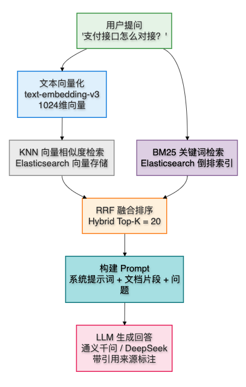


**KAG（知识增强生成）：**

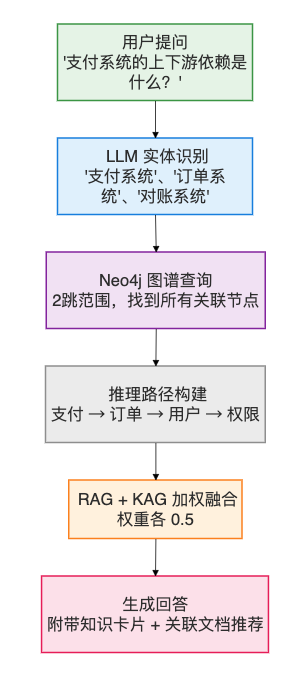


**AI 辅助写作：**
- 生成文档摘要
- 生成文档大纲
- 内容扩写与润色
- 表达优化
- 自动添加示例

**双模型支持：**
- 通义千问（qwen3-max）：阿里云 DashScope API
- DeepSeek（deepseek-chat）：DeepSeek 官方 API
- 可灵活切换，配置即可生效

### 3.5 知识图谱可视化

基于 Neo4j 图数据库构建知识网络，支持：

- **节点管理**：按类型（文档/用户/分类/标签）筛选
- **关系查询**：按源头/目标类型过滤
- **N 度关联**：查询任意节点 2-3 跳范围内的关联
- **路径分析**：两个知识点之间的最短路径
- **社区发现**：标签传播算法，自动识别知识集群
- **前端可视化**：ECharts 力导向图渲染，支持节点拖拽、缩放、高亮

### 3.6 权限管理（真正的企业级 RBAC）


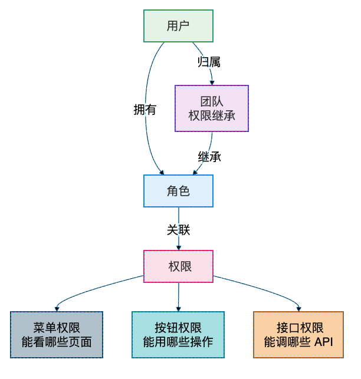


**完整功能：**
- 用户管理（创建、禁用、删除、重置密码）
- 角色管理（可自定义角色，灵活分配权限）
- 权限树（细粒度控制，精确到每个操作按钮）
- 团队管理（部门/项目组织形式，权限继承）
- JWT 无状态认证 + Token 自动刷新
- 全操作日志记录（谁在什么时候做了什么）

### 3.7 数据看板 & 统计分析

- **总览仪表盘**：文档总数、用户数、今日访问量、AI调用次数
- **文档趋势图**：按时间维度的创建/更新趋势
- **用户活跃度排行**：谁在贡献、谁在消费知识
- **分类分布图**：知识在各领域的分布情况
- **热门文档排行**：最受欢迎的技术文档 Top 10

### 3.8 实时通知系统

- WebSocket 实时推送
- RabbitMQ 异步消息处理
- 通知保留 90 天
- 支持已读/未读状态管理
- 支持管理员群发通知

### 3.9 Python 后端实现方案

如果你选择 Python 版后端，以下是 Python 版本中几个核心模块的亮点。

功能上与 Java 版对等，但实现方式更贴合 Python 生态特点。

**1. FastAPI 微服务体系**

Python 版拆分为 8 个独立 FastAPI 应用，通过 Nginx 反向代理或 Traefik 做网关路由：

| 模块 | 端口 | 职责 |
|------|------|------|
| gateway-service | 8000 | 统一入口、JWT 校验、CORS、限流 |
| auth-service | 8001 | 用户认证、RBAC 权限、团队管理 |
| document-service | 8002 | 文档 CRUD、分类、标签、评论、审核 |
| file-service | 8003 | 文件上传/下载、格式转换、HLS 转码 |
| search-service | 8004 | ES 全文检索、搜索建议、热词排行 |
| ai-service | 8006 | RAG/KAG 对话、AI 写作、LangGraph Agent |
| graph-service | 8008 | Neo4j 知识图谱的节点与关系管理 |
| statistics-service | 8005 | 数据看板、定时统计、用户活跃度 |

所有服务通过 `httpx` 异步客户端做服务间调用，JWT 认证通过 FastAPI 中间件统一拦截，`X-User-Id` Header 透传与 Java 版设计一致。

**2. 全链路 RAG Pipeline**

```
文档入库（document-service 异步触发）
  ├── LangChain RecursiveCharacterTextSplitter 智能分块
  │   ├── 自适应语义分块（段落边界感知，非暴力截断）
  │   └── 动态 chunk_size（256~1024，根据文档类型自动调整）
  ├── Celery EmbeddingTask → Sentence-Transformers BGE-M3 本地 Embedding
  │   ├── 1024维稠密向量，支持中英双语
  │   └── GPU 加速批处理（batch_size=32）
  ├── ES dense_vector 索引写入（或可选 Milvus）
  └── 查询时：BM25 + 向量双路召回 → RRF 融合
```

**3. LangGraph Agent 工作流**

Python 版的 AI 对话不是简单的一问一答，而是通过 LangGraph 构建的多步骤自主推理链：

| Agent 类型 | 能力 | 应用场景 |
|-----------|------|---------|
| SearchAgent | 按关键词、分类、标签检索文档 | "找一下支付接口文档" |
| RAGAgent | 语义检索 + LLM 生成答案 | "支付接口怎么对接？" |
| KAGAgent | 知识图谱遍历 + 关联推理 | "支付系统和哪些系统有关联？" |
| WritingAgent | 大纲生成 → 段落扩写 → 润色 | "帮我写一份支付系统接入指南" |
| SupervisorAgent | 调度上述 Agent，自主决策调用顺序 | "分析支付系统的整体架构" |

所有 Agent 通过 **LangGraph StateGraph** 串联，支持 Checkpointer 状态持久化与断点恢复。

**4. Celery 异步任务体系**

Python 版用 Celery + RabbitMQ 组合，做所有耗时操作的异步解耦：

- **DocumentParseTask**：Word/PDF 解析 → Markdown 转换
- **EmbeddingTask**：文档分块 + 向量嵌入 → 写回向量索引
- **EntityExtractionTask**：LLM 实体抽取 → Neo4j 图谱写入
- **SummaryTask**：文档摘要自动生成
- **TranscodeTask**：FFmpeg 视频转码（HLS 多码率）
- **IndexSyncTask**：ES 全文索引同步
- 进度推送：Celery task state → WebSocket → 前端百分比进度条

**5. Model Gateway 多模型网关**

```
┌─────────────────────────────────────────────────┐
│            FastAPI Model Gateway               │
├─────────────────────────────────────────────────┤
│  统一接口: POST /api/v1/chat/completions        │
├──────────┬──────────┬──────────┬───────────────┤
│  Qwen    │ DeepSeek │ GLM-4    │ 本地模型      │
│ (通义千问) │ (深度求索) │ (智谱)    │ (Ollama/vLLM) │
├──────────┴──────────┴──────────┴───────────────┤
│  自动 fallback：A 模型超时 → B 模型接管         │
│  智能路由：简单问答→DeepSeek / 复杂推理→Qwen     │
│  Token 计费：每次调用精确计算消耗 Token 和成本   │
│  速率控制：按模型 + 用户维度的 Token Bucket 限流 │
└─────────────────────────────────────────────────┘
```

如果在使用过程中有任何问题，或者对项目有什么建议，添加好友备注：知识库，可以跟3000+志同道合的朋友交流讨论。


## 四、系统展示

### 文档功能
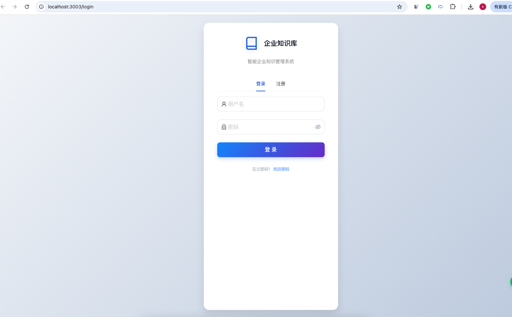

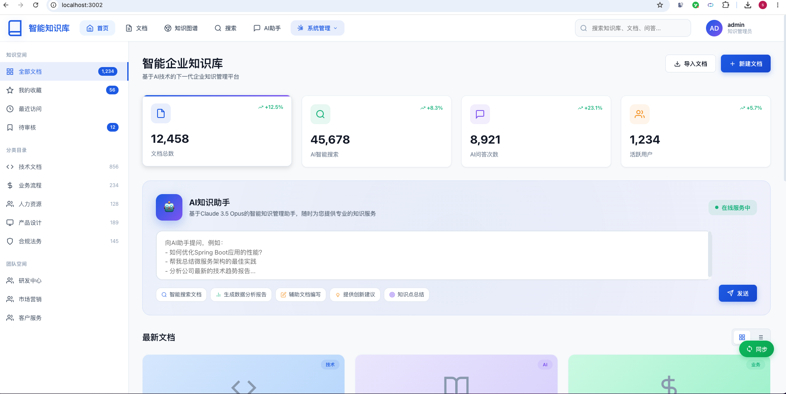

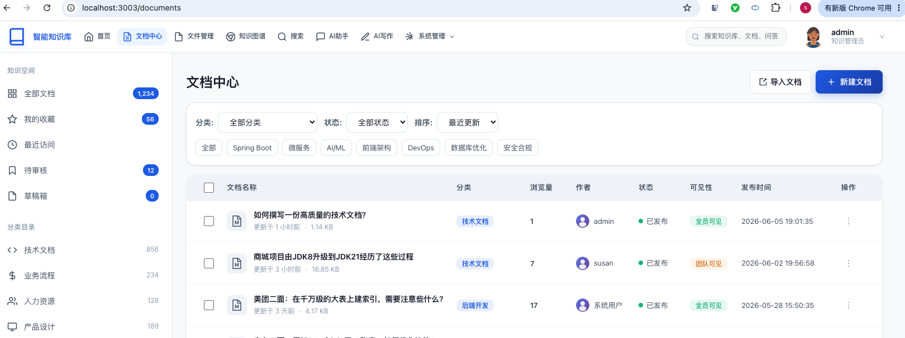


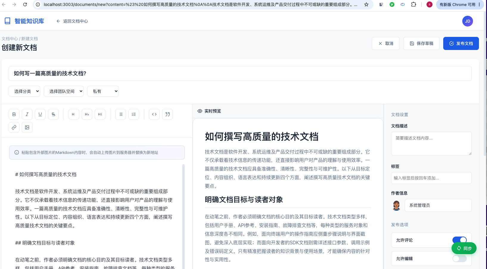


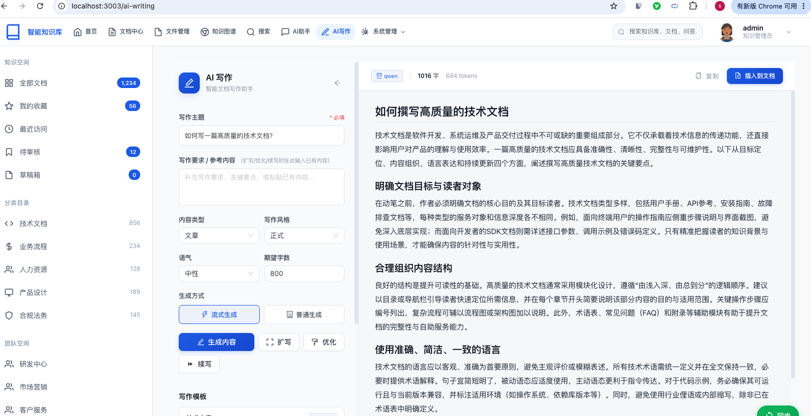

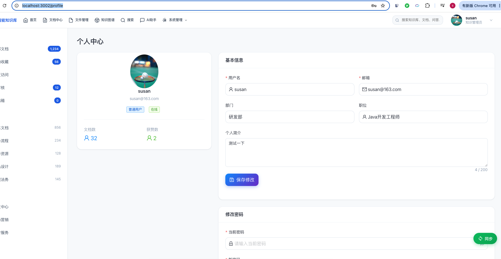

### 知识图谱
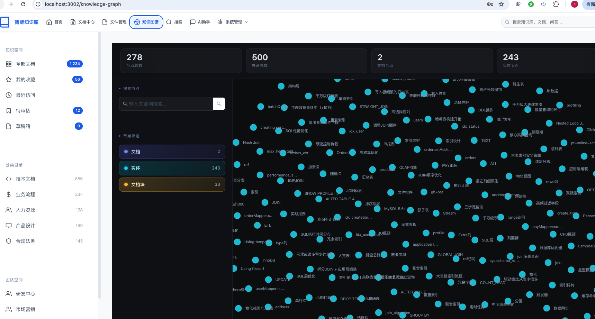

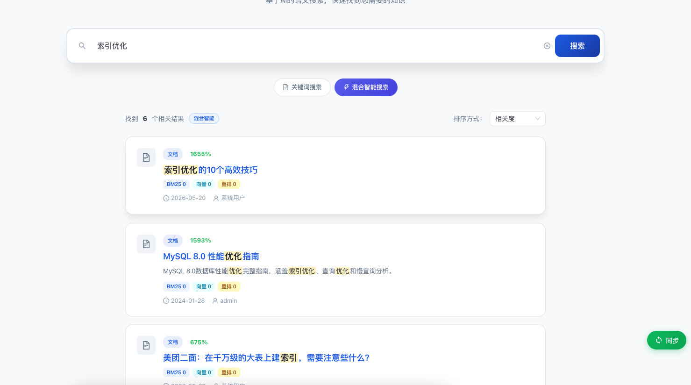


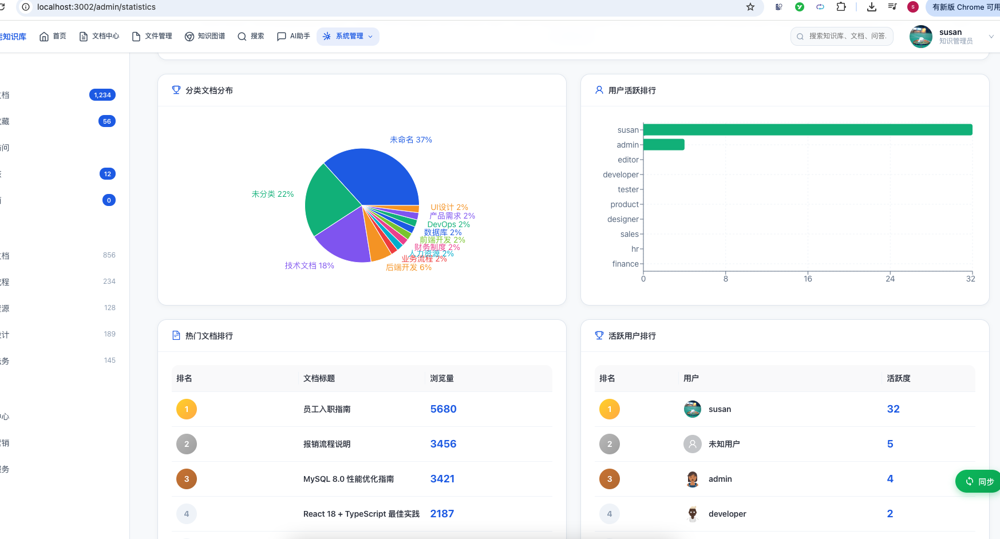

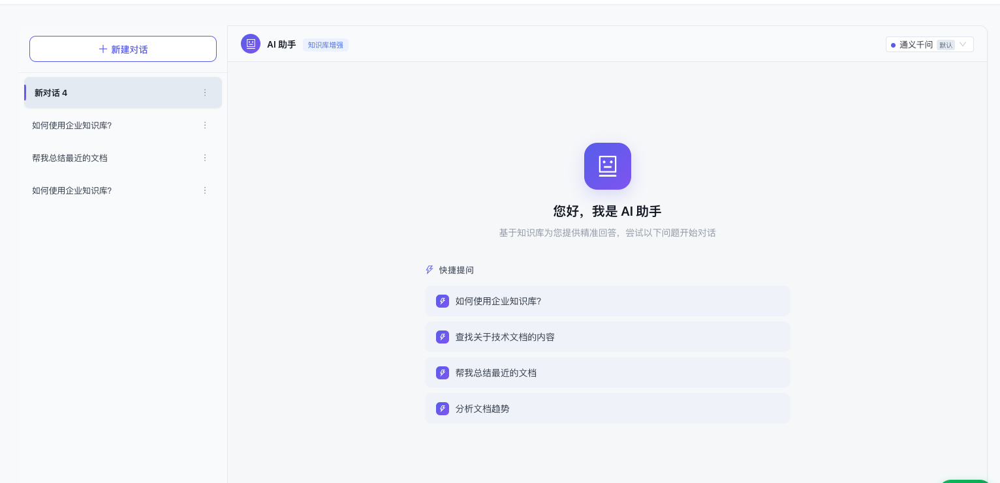

### 支持多种类型的文件
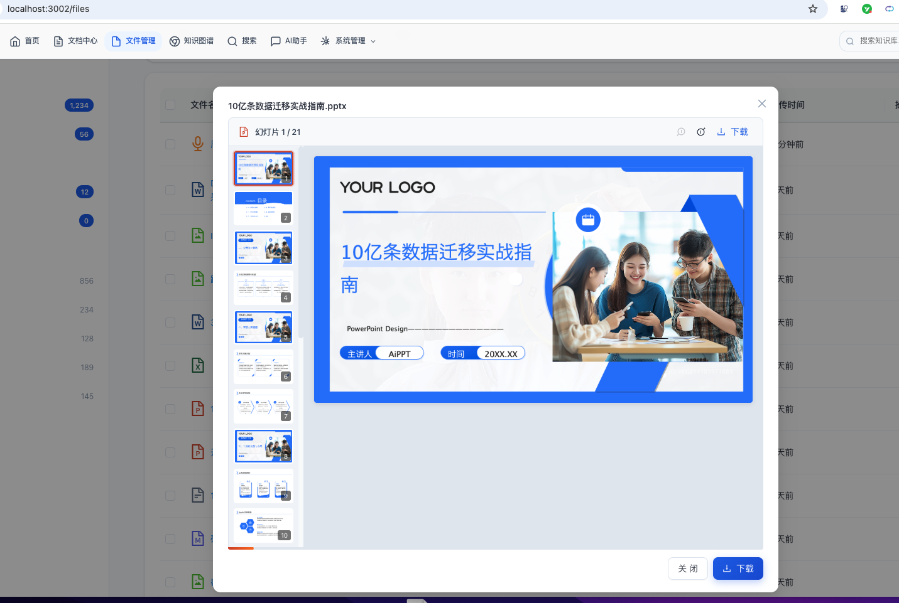

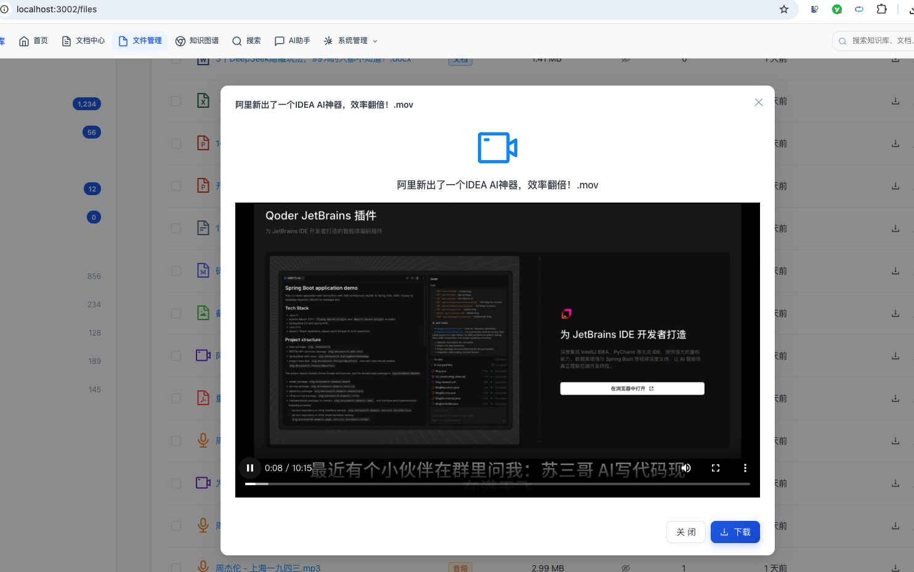

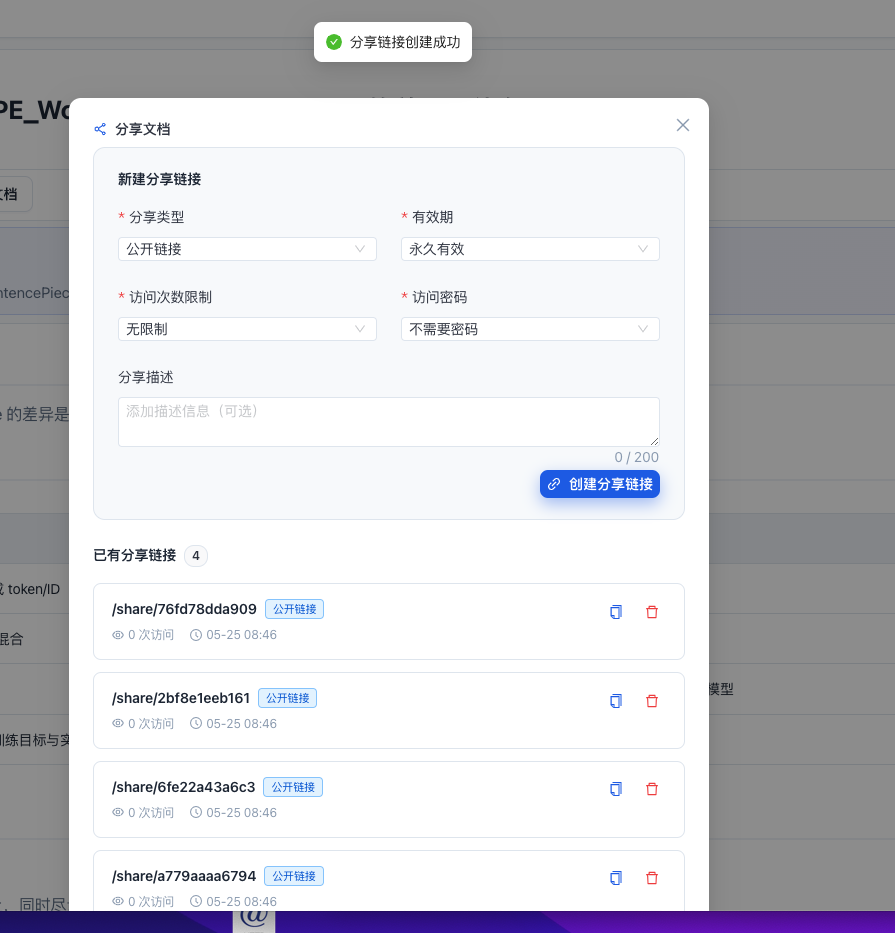
### 支持团队空间
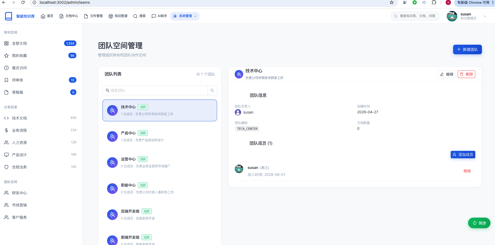

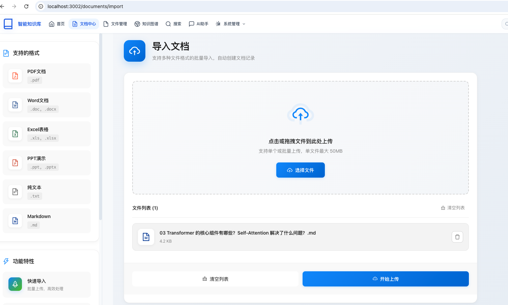

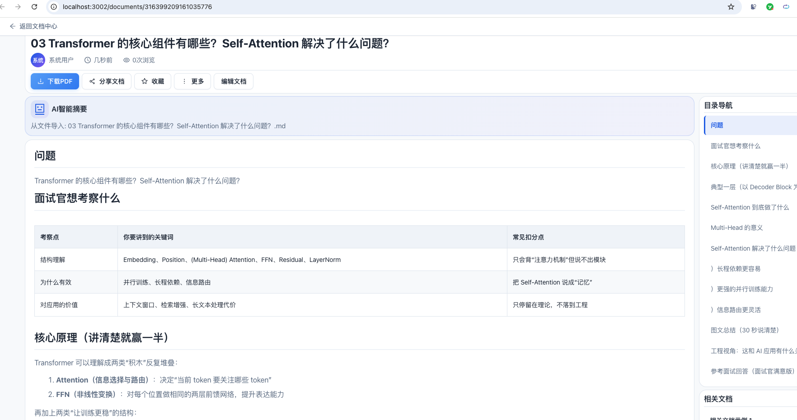


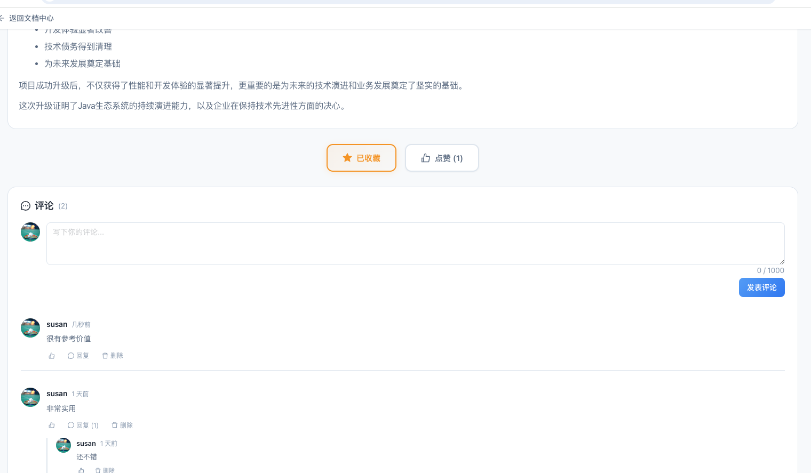


## 五、项目亮点

### 5.1 架构亮点

**1. 真正的微服务落地，不是"拆模块改个名"**

- 10 个微服务独立部署，每个服务有自己的数据库（9 个独立 MySQL 库）
- Nacos 服务注册与发现，服务间通过 Feign 声明式调用
- Spring Cloud Gateway 统一网关，JWT 认证在网关层统一处理
- 有明确的服务边界和调用关系，不是简单的 Maven 多模块

Gateway 的 `AuthGlobalFilter` 在请求进入时就完成 JWT 校验，提取用户信息后通过 `X-User-Id` Header 向下游透传。下游服务不再重复处理认证逻辑，只需要从 Header 中读取用户身份即可——关注点分离，代码更清爽。


服务间通信采用 Spring Cloud OpenFeign，用接口+注解的方式定义远程调用，完全不写 HTTP 连接代码。

所有 10 个服务启动后自动注册到 Nacos，支持健康检查、负载均衡、动态上下线。

**2. RAG + KAG 双引擎 AI 架构**

这不是简单的"接个 ChatGPT API"。

项目实现了一整套可插拔的 AI 引擎架构：

| 维度 | RAG 引擎 | KAG 引擎 |
|------|---------|---------|
| 数据来源 | 文档内容（向量化分块） | 知识图谱（Neo4j实体关系） |
| 检索方式 | Embedding 向量相似度 + BM25 混合检索 | LLM实体识别 → Neo4j 多跳遍历 |
| 核心优势 | 语义匹配，理解用户意图 | 结构化推理，发现隐含关联 |
| 融合策略 | RRF（Reciprocal Rank Fusion）加权融合，权重可调 | |

整个 pipeline 可拆解为独立步骤：文档分块（Chunking）→ 文本嵌入（Embedding）→ 向量索引（KNN）→ 混合检索 → 上下文构造 → LLM 生成。

每一个步骤都有独立的 Service 实现，方便替换或升级。


**3. 混合搜索（BM25 + 向量）**

不是简单的 ES LIKE 模糊查询，而是实现了搜索结果的多路召回 + 融合排序：

```
用户搜索 "如何提升系统性能"
  ├── 路径1: BM25 倒排索引关键词匹配 → 命中"性能优化"文档（精确但可能遗漏同义词）
  ├── 路径2: text-embedding-v3 向量语义匹配 → 命中"系统调优"文档（语义相近但用词不同）
  └── RRF 融合: 对两路结果按倒数排名加权融合，输出 Top-K=20 最终结果
```

向量 embedding 采用阿里云 text-embedding-v3 模型，1024 维向量存入 Elasticsearch 的 `dense_vector` 字段，支持 KNN 近似最近邻检索。

用户每次搜索异步写入 MySQL，定时任务聚合计算热词排行。

搜索历史支持个人维度管理（查看/清空/导出），热词排行面向全系统展示——既保护个人隐私，又提供全局趋势洞察。


**4. RabbitMQ 驱动的事件异步处理**

大量耗时操作通过 RabbitMQ 异步解耦，让核心流程保持快速响应：

| 事件 | 生产者 | 消费者 | 说明 |
|------|--------|--------|------|
| 操作日志 | AOP切面 | kb-foundation | 不阻塞业务请求 |
| 文档索引更新 | kb-document | kb-search/Consumer | 文档发布后异步更新 ES |
| RAG 向量化 | kb-document | kb-ai/ReindexConsumer | 文档发布后异步向量嵌入 |
| KAG 图谱构建 | kb-document | kb-ai/KAGReindexConsumer | 文档发布后异步构建图谱 |
| 视频转码 | kb-file | kb-file/TranscodeConsumer | 大文件转码不阻塞上传 |
| 通知推送 | 各服务 | kb-foundation | 消息异步分发 |

**6. 两套后端实现，自由选择**

这是本项目区别于绝大多数开源项目的核心亮点——**不是只有一套后端，而是 Java 和 Python 各有一套完整实现**：

| 维度 | Java 版 | Python 版 |
|------|--------|----------|
| 框架 | Spring Boot 3.2 + Spring Cloud | FastAPI 0.115 + LangChain |
| 微服务模块 | 10个 | 8个 |
| ORM | MyBatis Plus | SQLAlchemy 2.0+ |
| 认证 | Spring Security + JJWT | FastAPI Users + PyJWT |
| 异步任务 | RabbitMQ | Celery + Redis + RabbitMQ（Celery 做任务调度，RabbitMQ 做跨服务解耦） |
| 数据库 | MySQL ×9 + MongoDB + ES + Neo4j | 同一套数据库，接口兼容 |
| 服务间调用 | OpenFeign | httpx 异步客户端 |
| 部署 | JAR + Docker Compose | Uvicorn + Docker Compose |
| API 接口 | 用同一套 Swagger 规范，接口路径和参数一致 |
| 前端 | **共用同一套 React 前端，零改动切换** |

**设计哲学：** 大部分微服务开源项目只提供一种语言的实现，你喜欢的语言没做就只能将就。

这个项目两套都做了，功能完全对等。

你想用 Java 学习 Spring Cloud 全家桶，就用 Java 版；你想用 Python 学习 FastAPI + LangChain + AI 原生开发，就用 Python 版。

>**两套源码对应的完整实现与配套教程，见苏三官网项目实战页：[susan.net.cn/project](https://www.susan.net.cn/project)**


**5. 全格式文件预览体系**

涵盖 PDF、DOCX、XLSX、PPT、Markdown、TXT、图片、视频（HLS）、音频，用户不需要下载文件就能看到内容。

项目覆盖了企业日常能接触到的几乎所有文件格式，且不需要用户安装任何软件：

| 类别 | 支持格式 | 预览技术 | 关键库 |
|------|---------|---------|--------|
| PDF | .pdf | 分页渲染，支持缩放 | react-pdf 10.x |
| Word | .doc/.docx | HTML 实时转换 | mammoth.js |
| Excel | .xls/.xlsx | 交互式数据表格 | SheetJS (xlsx) |
| PPT | .ppt/.pptx | 幻灯片逐页预览 | 后端图片提取 |
| Markdown | .md | GFM 渲染 + 代码高亮 | react-markdown + PrismJS |
| 纯文本 | .txt | 等宽字体渲染 | 原生 |
| 图片 | png/jpg/gif/bmp/svg/webp | 缩略图 + 原图预览 | 原生 |
| 视频 | mp4/avi/mov/mkv/webm | HLS 自适应码率流播放 | FFmpeg + HTML5 Video |
| 音频 | mp3/wav/flac/aac/ogg | HTML5 音频播放 | 原生 Audio |
| 压缩包 | zip/rar/7z | 文件列表展示 | - |

视频上传后自动完成：SHA-256 完整性校验 → FFprobe 提取元数据（时长/分辨率/码率）→ 用户点击"转码"→ RabbitMQ 异步发送转码消息 → FFmpeg 生成 360p + 720p 多码率分片 → HLS .m3u8 播放列表 → 前端根据网络状况自动切换清晰度。

整个流程全异步、不阻塞用户操作，转码进度可通过 API 查询。

导入支持：Word (.docx) → Markdown, Markdown (.md) → 系统文档, 纯文本 (.txt) → 系统文档, 拖拽批量导入

导出支持：Markdown → PDF, Markdown → Word, Markdown → 原格式下载

构建了完整的文档格式转换 pipeline，知识进得来也出得去。

### 5.2 工程亮点

| 分类 | 亮点数 | 核心关键词 |
|------|--------|-----------|
| 微服务架构 | 6 | 数据库-per-服务、Gateway鉴权透传、Feign声明式调用、Nacos注册配置、**Java/Python双后端实现**、功能完全对等 |
| AI/LLM | 7 | RAG+KAG双引擎、**LangChain+LangGraph Agent编排**、混合检索RRF融合、LLM自动构建知识图谱、SSE流式输出、双模型切换、反馈闭环 |
| Python 后端 | 5 | **FastAPI异步微服务**、**Celery异步任务队列**、**SQLAlchemy 2.0异步ORM**、**Sentence-Transformers本地Embedding**、**Model Gateway多模型网关** |
| 搜索技术 | 2 | BM25+向量混合检索+RRF融合、异步热词分析 |
| 权限安全 | 4 | 三层RBAC、Token刷新请求队列、防全表更新拦截器、AOP注解审计 |
| 存储文件 | 3 | 全格式预览矩阵、HLS自适应流媒体、SHA-256秒传去重 |
| 数据工程 | 4 | Snowflake分布式ID、逻辑删除审计、消息队列事件驱动、定时统计 |
| 前端工程 | 4 | Axios拦截体系、Zustand持久化、路由懒加载守卫、TS零错误 |
| 运维工程 | 4 | 全局异常处理、Knife4j在线文档、虚拟线程 |

### 5.3 这套源码能带给你什么？

**如果你是一个 Java 后端开发：**
- 微服务怎么拆、怎么做服务发现、怎么写 Feign 接口，这项目里全有
- JWT + RBAC 权限模型怎么设计，代码怎么写，直接看 `kb-user-auth`
- MyBatis Plus 的高级用法（分页、连表、动态 SQL、逻辑删除）
- Elasticsearch 全文检索 + 向量搜索怎么实际落地
- RabbitMQ 异步消息怎么在真实的业务场景里用
- AOP 切面编程实现操作日志和限流

**如果你是一个 Python 后端开发：**
- FastAPI 如何构建生产级异步微服务（asyncio + Uvicorn + Gunicorn）
- SQLAlchemy 2.0 异步 ORM 的高级用法（连表、分页、软删除、事务管理）
- FastAPI Users + PyJWT 实现 JWT 认证 + RBAC 权限体系
- Celery + Redis 构建异步任务队列（文档解析、向量嵌入、视频转码）
- LangChain + LangGraph 搭建多 Agent 自主协作系统
- Sentence-Transformers 本地 Embedding 做向量检索（GPU 批处理）
- Model Gateway：多模型统一接口、智能路由、自动 fallback
- httpx 异步客户端做微服务间 RPC 通信
- Pydantic 2.x 做严格的数据校验与 API Schema 定义
- Alembic 数据库版本迁移管理

**如果你是一个前端开发：**
- React 18 + TypeScript 5 企业级项目怎么组织目录和代码
- Zustand 状态管理 + persist 持久化的最佳实践
- Axios 拦截器、Token 刷新、请求重试队列的完整方案
- Ant Design 5 的深度定制（自定义主题、国际化）
- ECharts 在 React 中怎么封装和使用
- 文件上传（大文件分片）、文件预览（PDF/DOCX/XLSX/MD）怎么实现

**如果你关注 AI / LLM：**
- RAG 完整 pipeline 的代码实现（从文档分块到向量检索到 LLM 生成）
- KAG 完整 pipeline 的代码实现（从实体抽取到图谱构建到融合检索）
- Java 版用 LangChain4j、Python 版用 LangChain——**两种技术路线对比学习**
- Elasticsearch 向量存储的方案设计和落地
- Neo4j 知识图谱如何由 LLM 驱动自动构建
- 多模型（Qwen + DeepSeek）切换的架构设计

**如果你是架构师或技术 Leader：**
- 微服务怎么拆，每个服务的边界如何定义
- 9 个数据库的设计理由、ER 关系、索引策略
- 7 种中间件的选型理由和使用场景
- **Java vs Python 技术选型**：同一个系统用两种语言分别实现，你可以直接对比两种技术栈的工程差异、性能特点、开发效率，这对技术选型决策非常有参考价值


### 5.4 本项目配套教程（官网直达）

本项目的完整开发教程已在官网连载，点击标题即可跳转到官网对应页面：

**从 0 到 1 开发教程**

- [01 企业智能知识库系统项目介绍](https://www.susan.net.cn/project/knowledge/1.info.html)
- [02 企业智能知识库系统设计](https://www.susan.net.cn/project/knowledge/2.systemdesign.html)
- [03 企业智能知识库系统数据库表设计](https://www.susan.net.cn/project/knowledge/3.tabledesign.html)
- [04 搭建后端项目骨架](https://www.susan.net.cn/project/knowledge/4.projectdemo.html)
- [05 增加公共基础服务功能（一）](https://www.susan.net.cn/project/knowledge/5.commonservice1.html)
- [06 增加公共基础服务功能（二）](https://www.susan.net.cn/project/knowledge/6.commonservice2.html)
- [07 增加文档服务功能](https://www.susan.net.cn/project/knowledge/7.documentservice.html)
- [08 增加分类相关功能](https://www.susan.net.cn/project/knowledge/8.category.html)
- [09 增加标签相关功能](https://www.susan.net.cn/project/knowledge/9.tag.html)
- [10 增加版本相关功能](https://www.susan.net.cn/project/knowledge/10.version.html)
- [11 增加评价相关功能](https://www.susan.net.cn/project/knowledge/11.comment.html)
- [12 增加文档审核相关功能](https://www.susan.net.cn/project/knowledge/12.audit.html)
- [13 网关服务统一封装返回值](https://www.susan.net.cn/project/knowledge/13.gateway.html)
- [14 实现用户登录和认证功能（一）](https://www.susan.net.cn/project/knowledge/14.login1.html)
- [15 实现用户登录和认证功能（二）](https://www.susan.net.cn/project/knowledge/15.login2.html)
- [16 增加文件上传功能](https://www.susan.net.cn/project/knowledge/16.upload.html)
- [17 增加文档查询、创建和删除功能](https://www.susan.net.cn/project/knowledge/17.documentcrud.html)
- [18 增加分类管理和用户管理功能](https://www.susan.net.cn/project/knowledge/18.categoryuser.html)
- [19 增加导入文档和草稿箱功能](https://www.susan.net.cn/project/knowledge/19.importdraft.html)
- [20 增加我的收藏和最近访问功能](https://www.susan.net.cn/project/knowledge/20.favorite.html)
- [21 增加PDF文档下载和文档分享功能](https://www.susan.net.cn/project/knowledge/21.pdfshare.html)
- [22 增加AI助手功能](https://www.susan.net.cn/project/knowledge/22.aiassistant.html)
- [23 增加RAG知识库功能](https://www.susan.net.cn/project/knowledge/23.rag.html)
- [24 图数据库Neo4j入门教程](https://www.susan.net.cn/project/knowledge/24.neo4j.html)
- [25 增加KAG知识图谱功能](https://www.susan.net.cn/project/knowledge/25.kag.html)
- [26 增加智能搜索功能](https://www.susan.net.cn/project/knowledge/26.search.html)
- [27 增加文件管理功能，支持音频和视频](https://www.susan.net.cn/project/knowledge/27.file.html)
- [28 增加团队空间管理功能](https://www.susan.net.cn/project/knowledge/28.teamspace.html)
- [29 完善文档评价、点赞和收藏功能](https://www.susan.net.cn/project/knowledge/29.interaction.html)
- [30 增加导出数据页面功能](https://www.susan.net.cn/project/knowledge/30.export.html)
- [31 完善个人中心功能](https://www.susan.net.cn/project/knowledge/31.profile.html)
- [32 完善统计中心功能](https://www.susan.net.cn/project/knowledge/32.statistics.html)
- [33 增加AI写作功能](https://www.susan.net.cn/project/knowledge/33.aiwriting.html)
- [34 增加文档详情中的AI智能摘要功能](https://www.susan.net.cn/project/knowledge/34.summary.html)
- [35 增加文档审核功能](https://www.susan.net.cn/project/knowledge/35.docaudit.html)
- [36 增加WebSocket消息实时推送功能](https://www.susan.net.cn/project/knowledge/36.websocket.html)
- [37 增加Word、PDF等多文件数据解析功能](https://www.susan.net.cn/project/knowledge/37.word.html)
- [38 完善注册、邮件验证和找回密码功能](https://www.susan.net.cn/project/knowledge/38.user.html)
- [39 增加文档自动保存功能](https://www.susan.net.cn/project/knowledge/39.autosave.html)
- [40 将MQ改成按本地环境隔离](https://www.susan.net.cn/project/knowledge/40.enviment.html)
- [41 AI对话改成流式输出&增加记忆功能](https://www.susan.net.cn/project/knowledge/41.memory.html)

**深度专题**

- [企业智能知识库系统之系统架构](https://www.susan.net.cn/project/knowledge/systemdesgin.html)
- [企业智能知识库系统之代码结构详解](https://www.susan.net.cn/project/knowledge/code.html)
- [企业智能知识库系统之文档生命周期与审核闭环](https://www.susan.net.cn/project/knowledge/document.html)
- [企业智能知识库系统之RAG增强问答](https://www.susan.net.cn/project/knowledge/initdata.html)
- [企业智能知识库系统之KAG图谱增强推理](https://www.susan.net.cn/project/knowledge/initdata.html)
- [企业智能知识库系统之多模型接入与切换](https://www.susan.net.cn/project/knowledge/initdata.html)
- [企业智能知识库系统之认证与授权体系](https://www.susan.net.cn/project/knowledge/initdata.html)
- [企业智能知识库系统之跨服务通信架构](https://www.susan.net.cn/project/knowledge/initdata.html)
- [企业智能知识库系统之RBAC权限体系](https://www.susan.net.cn/project/knowledge/initdata.html)
- [企业智能知识库系统之实时通知推送](https://www.susan.net.cn/project/knowledge/initdata.html)
- [企业智能知识库系统之全文检索设计](https://www.susan.net.cn/project/knowledge/initdata.html)
- [企业智能知识库系统之事件驱动架构](https://www.susan.net.cn/project/knowledge/initdata.html)
- [企业智能知识库系统之前端状态管理](https://www.susan.net.cn/project/knowledge/initdata.html)
- [企业智能知识库系统之前端API层设计](https://www.susan.net.cn/project/knowledge/initdata.html)

**Python 后端**

- [企业智能知识库Python后端项目介绍](https://www.susan.net.cn/project/knowledge/initdata.html)
- [企业智能知识库Python后端本地运行（指南）](https://www.susan.net.cn/project/knowledge/initdata.html)
- [企业智能知识库Python后端系统架构](https://www.susan.net.cn/project/knowledge/initdata.html)

**运行指南 & 资料**

- [企业智能知识库系统最新初始化数据](https://www.susan.net.cn/project/knowledge/initdata.html)
- [企业智能知识库系统本地运行（指南）](https://www.susan.net.cn/project/knowledge/run.html)
- [企业智能知识库系统如何包装简历？](https://www.susan.net.cn/project/knowledge/resume.html)
- [企业智能知识库项目权限申请](https://www.susan.net.cn/project/knowledge/permission.html)
- [更多精彩内容...](https://www.susan.net.cn/project/knowledge/more.html)
